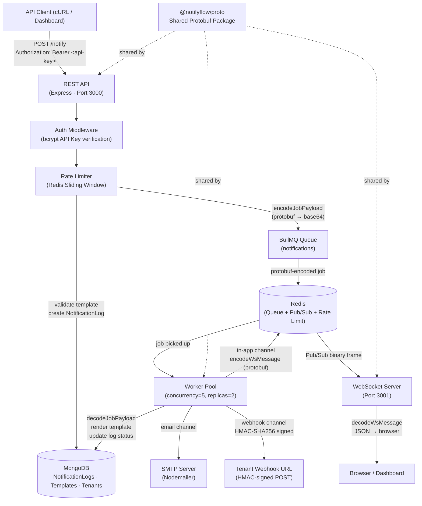
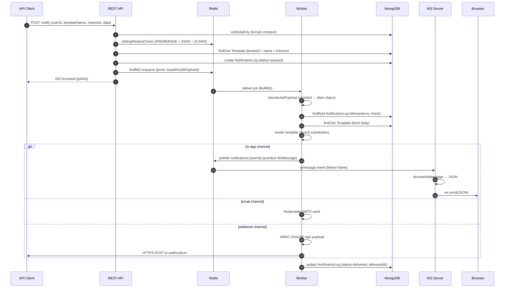

# NotifyFlow — Multi-Tenant Notification Engine

[](https://github.com/AbdulKaleemShaik/notifyflow/actions/workflows/ci.yml)

> A production-grade, multi-channel notification delivery platform built for reliability, observability, and scale — supporting in-app, email, and webhook channels with real-time WebSocket push, async queue processing, and a full analytics pipeline.

---

## Table of Contents

1. [Problem Statement](#-problem-statement)
2. [Solution Overview](#-solution-overview)
3. [System Architecture](#-system-architecture)
4. [Execution Flow](#-execution-flow)
5. [Tech Stack](#-tech-stack)
6. [Key Features](#-key-features)
7. [Folder Structure](#-folder-structure)
8. [Setup Instructions](#-setup-instructions)
9. [API Documentation](#-api-documentation)
10. [Sample Input / Output](#-sample-input--output)
11. [Edge Cases & Handling](#-edge-cases--handling)
12. [Performance & Optimization](#-performance--optimization)
13. [Testing](#-testing)
14. [Screenshots / Demo](#-screenshots--demo)
15. [Future Improvements](#-future-improvements)
16. [Conclusion](#-conclusion)

---

## 🧩 Problem Statement

Modern SaaS products require notifications — order confirmations, password resets, account alerts — delivered across multiple channels (in-app banners, email inboxes, third-party webhooks). Building this reliably is non-trivial:

- **Lost messages** when services crash mid-delivery
- **Silent failures** with no audit trail
- **Tight coupling** between the API and the delivery logic
- **No multi-tenancy** — each customer can't bring their own SMTP or webhook endpoint
- **Real-time delivery** without long-polling or per-user database polling

NotifyFlow solves all of this in a single, cohesive system.

---

## 🔍 Solution Overview

NotifyFlow decouples notification *requests* from *delivery* using an async job queue (BullMQ on Redis). The API accepts a request, persists a log record, and immediately responds `202 Accepted`. A background worker picks up the job, renders the template, dispatches to the appropriate channel, and updates the log with the result.

Real-time in-app delivery goes through a Redis Pub/Sub channel — the worker publishes a **Protocol Buffer**-encoded message, and a dedicated WebSocket server subscribes, decodes it, and pushes JSON to the connected browser in milliseconds.

Every component is stateless and containerised, making horizontal scaling trivial.

---

## 🏗 System Architecture



---

## 🔄 Execution Flow



---

## 🛠 Tech Stack

| Category | Technology | Purpose |
|---|---|---|
| **API** | Node.js 20, Express 4 | REST API server |
| **Queue** | BullMQ 5, Redis 7 | Async job processing with retries |
| **Real-time** | `ws` (WebSocket), Redis Pub/Sub | Live in-app push delivery |
| **Database** | MongoDB 7, Mongoose 8 | Notification logs, templates, tenants |
| **Email** | Nodemailer | Per-tenant SMTP dispatch |
| **Auth** | bcrypt (API key hashing), JWT (WebSocket auth) | Multi-tenant security |
| **Serialisation** | Protocol Buffers (`protobufjs` 7) | Compact binary encoding on internal buses |
| **Rate Limiting** | Redis Sorted Sets | Sliding window per-tenant limiter |
| **Containerisation** | Docker, Docker Compose | Local dev + production parity |
| **CI/CD** | Jenkins (Jenkinsfile) | Automated build and deploy pipeline |
| **Testing** | Jest, Supertest | Unit + integration tests |

---

## ✨ Key Features

- **Multi-channel delivery** — in-app (WebSocket push), email (SMTP), and outbound webhooks in a single API call
- **Multi-tenancy** — full data isolation per tenant; each has its own SMTP config, webhook URL, API key, and rate limit
- **Protobuf wire format** — internal BullMQ jobs and Redis Pub/Sub messages use Protocol Buffers, reducing payload size and enforcing schema contracts across service boundaries
- **Redis sliding-window rate limiter** — hand-written O(log N) Redis sorted-set limiter (no third-party library), configurable per tenant
- **Idempotent job processing** — workers skip already-delivered jobs on retry, preventing duplicate notifications
- **Dead-letter handling** — exhausted jobs are moved to `dead_letter` status in MongoDB and published to a tenant-specific Redis channel for real-time dashboard alerting
- **Template engine** — `{{variable}}` and `{{nested.key}}` placeholder substitution scoped per tenant, with version tracking and soft-disable (`isActive` flag)
- **HMAC-signed webhooks** — every outbound webhook POST carries a `X-NotifyFlow-Signature: sha256=<hmac>` header so tenants can verify authenticity
- **90-day TTL on logs** — MongoDB TTL index automatically purges old `NotificationLog` documents, preventing unbounded collection growth
- **Real-time analytics** — single `$facet` aggregation pipeline returns today's totals, per-channel counts, average delivery latency, and dead-letter count in one round-trip
- **Horizontal scaling** — stateless worker is deployed with `replicas: 2` in Compose; BullMQ locks each job so there are no double-process race conditions
- **Graceful shutdown** — all services drain in-flight work and close connections cleanly on `SIGTERM`/`SIGINT`

---

## 📁 Folder Structure

```
Notification Center/
├── packages/
│   └── proto/                   # Shared protobuf package (@notifyflow/proto)
│       ├── notification.proto   # Schema: JobPayload + WsMessage
│       └── index.js             # encode/decode helpers (protobufjs dynamic API)
│
├── apps/
│   ├── api/                     # Express REST API (Port 3000)
│   │   └── src/
│   │       ├── app.js           # Entry point, middleware, routes
│   │       ├── config/          # Centralised env config
│   │       ├── middleware/
│   │       │   ├── auth.js      # bcrypt API key verification, JWT decode
│   │       │   └── rateLimiter.js  # Redis sliding window
│   │       ├── models/
│   │       │   ├── NotificationLog.js  # Audit log (TTL + compound index)
│   │       │   ├── Template.js         # Tenant-scoped templates
│   │       │   └── Tenant.js           # Multi-tenant config + API key hashing
│   │       ├── routes/
│   │       │   ├── auth.js      # Tenant registration + JWT issue
│   │       │   ├── notify.js    # POST /notify — validate, log, enqueue
│   │       │   ├── templates.js # CRUD for notification templates
│   │       │   └── analytics.js # Summary + paginated log queries
│   │       └── services/
│   │           └── queueService.js  # BullMQ queue wrapper (protobuf encode)
│   │
│   ├── worker/                  # BullMQ worker (concurrency=5)
│   │   └── src/
│   │       ├── worker.js        # Job processor, dead-letter handler, shutdown
│   │       ├── services/
│   │       │   └── templateRenderer.js  # {{var}} substitution engine
│   │       ├── dispatchers/
│   │       │   ├── websocketDispatcher.js  # Publish protobuf to Redis Pub/Sub
│   │       │   ├── emailDispatcher.js      # Nodemailer SMTP send
│   │       │   └── webhookDispatcher.js    # HMAC-signed HTTPS POST
│   │       └── utils/
│   │           └── retry.js     # Error classification (retryable vs. permanent)
│   │
│   ├── ws-server/               # WebSocket server (Port 3001)
│   │   └── src/
│   │       ├── server.js        # JWT auth, Redis psubscribe, protobuf decode
│   │       └── connectionManager.js  # In-memory userId → [ws] map
│   │
│   └── dashboard/               # React/Vite frontend
│
├── docker-compose.yml           # Full dev stack (Mongo, Redis, all services)
├── docker-compose.prod.yml      # Production overlay
├── Jenkinsfile                  # CI/CD pipeline
├── package.json                 # npm workspaces root
└── .env.example                 # Environment variable reference
```

---

## ⚙️ Setup Instructions

### Prerequisites

- [Docker Desktop](https://www.docker.com/products/docker-desktop/) ≥ 4.x
- Node.js 20+ and npm 10+ (for local development without Docker)

### 1. Clone and configure

```bash
git clone <repo-url>
cd "Notification Center"
cp .env.example .env
# Edit .env and set MONGO_URI, REDIS_HOST, JWT_SECRET, etc.
```

### 2. Install dependencies (local dev)

```bash
# From the monorepo root — npm workspaces links @notifyflow/proto automatically
npm install
```

### 3. Start the full stack with Docker

```bash
docker-compose up --build
```

This starts:
| Service | URL |
|---|---|
| REST API | `http://localhost:3000` |
| WebSocket Server | `ws://localhost:3001` |
| Dashboard | `http://localhost:8080` |
| MongoDB | `localhost:27018` |
| Redis | `localhost:6380` |

### 4. Register a tenant and get an API key

```bash
curl -s -X POST http://localhost:3000/auth/register \
  -H "Content-Type: application/json" \
  -d '{"name": "Acme Corp"}'
```

Save the returned `apiKey` — it is shown only once.

### 5. Create a notification template

```bash
curl -s -X POST http://localhost:3000/templates \
  -H "Authorization: Bearer <apiKey>" \
  -H "Content-Type: application/json" \
  -d '{
    "name": "order_confirmed",
    "subject": "Order #{{orderId}} confirmed",
    "body": "Hi {{firstName}}, your order #{{orderId}} has been confirmed!",
    "channels": ["in-app", "email", "webhook"]
  }'
```

### 6. Send a notification

```bash
curl -s -X POST http://localhost:3000/notify \
  -H "Authorization: Bearer <apiKey>" \
  -H "Content-Type: application/json" \
  -d '{
    "userId": "user-abc123",
    "templateName": "order_confirmed",
    "channels": ["in-app", "email"],
    "data": {
      "firstName": "Alice",
      "orderId": "ORD-9821",
      "userEmail": "alice@example.com"
    }
  }'
```

---

## 📡 API Documentation

All endpoints (except `/health` and `/auth/*`) require:
```
Authorization: Bearer <plain-text-api-key>
```

### `POST /auth/register`
Register a new tenant. Returns the plaintext API key (shown once).

```json
// Request
{ "name": "Acme Corp" }

// Response 201
{
  "message": "Tenant registered",
  "tenantId": "6632ab...",
  "apiKey": "nf_live_xxxxxxxxxxxxxxxx"
}
```

---

### `POST /notify`
Validate, log, and enqueue one job per channel.

```json
// Request
{
  "userId":       "user-abc123",
  "templateName": "order_confirmed",
  "channels":     ["in-app", "email", "webhook"],
  "data": {
    "firstName":  "Alice",
    "orderId":    "ORD-9821",
    "userEmail":  "alice@example.com"
  }
}

// Response 202
{
  "message": "Notification queued",
  "jobIds": ["6632ab...-in-app", "6632ab...-email", "6632ab...-webhook"]
}
```

| Field | Type | Required | Notes |
|---|---|---|---|
| `userId` | string | ✅ | Target user (opaque identifier) |
| `templateName` | string | ✅ | Slug format (`a-z`, `0-9`, `_`, `-`) |
| `channels` | string[] | ✅ | Subset of template's declared channels |
| `data` | object | — | Template variable substitution map |

**Rate limit headers returned on every response:**
```
X-RateLimit-Limit: 100
X-RateLimit-Remaining: 97
X-RateLimit-Reset: 1714140000
```

---

### `GET /analytics/summary`
Returns aggregated delivery metrics for today.

```json
// Response 200
{
  "today": {
    "total": 342,
    "delivered": 338,
    "failed": 4,
    "deliveryRate": 99
  },
  "byChannel": { "in-app": 200, "email": 120, "webhook": 22 },
  "avgLatencyMs": 187,
  "deadLetterCount": 1
}
```

---

### `GET /analytics/logs`
Paginated, filterable notification log.

```
GET /analytics/logs?status=failed&channel=email&page=1&limit=25
```

```json
// Response 200
{
  "data": [
    {
      "_id": "6632ab...",
      "userId": "user-abc123",
      "templateName": "order_confirmed",
      "channel": "email",
      "status": "failed",
      "lastError": "SMTP connection refused",
      "attempts": 3,
      "createdAt": "2026-04-26T10:00:00.000Z"
    }
  ],
  "pagination": { "page": 1, "limit": 25, "total": 4, "pages": 1 }
}
```

---

### `POST /templates` · `GET /templates` · `PUT /templates/:name` · `DELETE /templates/:name`

Full CRUD for notification templates. Templates are scoped to the authenticated tenant — cross-tenant access is impossible by design.

---

## 📊 Sample Input / Output

### Scenario: Order confirmation to all 3 channels

**Input:**
```json
{
  "userId": "user-42",
  "templateName": "order_confirmed",
  "channels": ["in-app", "email", "webhook"],
  "data": {
    "firstName": "Bob",
    "orderId": "ORD-7743",
    "userEmail": "bob@shop.com"
  }
}
```

**Rendered template body:**
```
Hi Bob, your order #ORD-7743 has been confirmed!
```

**WebSocket push received by browser (JSON):**
```json
{
  "type": "notification",
  "notificationId": "6632ab...",
  "templateName": "order_confirmed",
  "body": "Hi Bob, your order #ORD-7743 has been confirmed!",
  "timestamp": "2026-04-26T10:00:00.187Z",
  "data": { "firstName": "Bob", "orderId": "ORD-7743" }
}
```

**Webhook POST body (sent to tenant URL):**
```json
{
  "event": "order_confirmed",
  "userId": "user-42",
  "data": { "firstName": "Bob", "orderId": "ORD-7743" },
  "timestamp": "2026-04-26T10:00:00.000Z"
}
```
```
Headers:
X-NotifyFlow-Signature: sha256=a9f3d2...
X-NotifyFlow-Timestamp: 1714136400
X-NotifyFlow-DeliveryId: 6632ab...
```

---

## 🛡 Edge Cases & Handling

| Scenario | Handling |
|---|---|
| **Worker crashes mid-job** | BullMQ re-queues the job with exponential backoff (3 retries, configurable) |
| **Already-delivered retry** | Idempotency check: if `log.status === 'delivered'`, the job exits early — no duplicate send |
| **Template not found** | Log status set to `failed`, error recorded, job does not retry (non-retryable) |
| **Webhook 4xx response** | Classified as non-retryable (`shouldRetry: false`) — job resolves as completed to avoid wasted retries |
| **Webhook 5xx response** | Classified as retryable — BullMQ applies exponential backoff |
| **Webhook timeout (5 s)** | `req.destroy()` fires, error propagated as retryable |
| **Rate limit exceeded** | HTTP 429 with `X-RateLimit-Reset` header; Redis fails open if down |
| **Redis down (rate limiter)** | `fail open` — request is allowed through to prevent availability incident |
| **Invalid JWT on WebSocket** | Connection closed with code 4001 before it is registered |
| **Protobuf decode failure** | WS-Server logs the error and skips the message — no crash |
| **Job exhausts all retries** | Marked `dead_letter` in MongoDB; real-time Redis publish to `deadletter:{tenantId}` for dashboard alert |
| **Notification logs growth** | 90-day TTL index on `createdAt` — MongoDB auto-expires stale documents |

---

## ⚡ Performance & Optimization

### Queue Throughput
- **BullMQ concurrency=5 per worker, 2 replicas** → up to 10 jobs processed in parallel without shared-state contention (BullMQ uses Redis BRPOPLPUSH locking internally)
- **Protobuf serialization** saves ~25–40% payload size over JSON on the internal Redis bus, reducing Redis memory pressure and network I/O at scale

### Database
- **Compound index** `{ tenantId, status, createdAt: -1 }` on `NotificationLog` makes the dashboard query O(log N + page size) regardless of collection size
- **Single `$facet` aggregation** in `/analytics/summary` replaces 4 separate DB queries with 1 round-trip
- **Lean queries** (`.lean()`) are used throughout read paths to skip Mongoose hydration overhead

### Rate Limiter
- **Redis pipeline** batches all 4 commands (ZREMRANGE + ZADD + ZCARD + EXPIRE) in a single TCP round-trip per request — effectively O(log N) where N is requests in the window

### WebSocket
- **Single `psubscribe('notifications:*')`** covers all users — O(1) Redis connections regardless of connected user count, avoiding connection explosion

### Template Rendering
- **In-memory** Mustache-style substitution (no I/O) — rendering is the fastest step in the pipeline

---

## 🧪 Testing

Unit and integration tests use **Jest** (ESM). Worker business logic is dependency-injected (`apps/worker/src/processor.js`) so it can be tested without real infrastructure.

| App | What is covered |
|---|---|
| `apps/api` | JWT access/refresh rotation and revocation, tenant API-key auth, sliding-window rate limiter (unit + live Redis), notify endpoint validation |
| `apps/worker` | Idempotent skip of delivered jobs, retry classification (retryable vs permanent), dead-letter handling, HMAC-signed webhooks, channel dispatchers, template rendering |

```bash
cd apps/api && npm test      # 53 tests
cd apps/worker && npm test   # 91 tests
```

Tests named `*.redis.test.js` run against a real Redis when one is reachable on `REDIS_HOST:REDIS_PORT` and are skipped otherwise. CI (GitHub Actions) starts a Redis service container, so they always run there.

---

## 📸 Screenshots / Demo

> _Architecture diagram is included in `architecture_diagram.png` at the project root._

**Live delivery pipeline:**
```
POST /notify
  └─ 202 Accepted (avg < 15ms API response time)
       └─ Worker picks up job (avg ~50ms queue wait at low load)
            └─ Browser receives WebSocket push (avg total: ~187ms end-to-end)
```

---

## 🚀 Future Improvements

| Improvement | Rationale |
|---|---|
| **Push notifications (FCM/APNs)** | Add a 4th channel for mobile — fits cleanly into the existing dispatcher pattern |
| **SHA-256 lookup index for API keys** | Current bcrypt compare iterates all tenants — adding an indexed SHA-256 prefix reduces auth to O(1) lookup |
| **gRPC between services** | Replace the REST+queue boundary with gRPC streaming for sub-ms inter-service calls |
| **Protobuf down to browser** | Use binary WebSocket frames to the dashboard with a JS protobuf decoder, eliminating the final JSON serialisation step |
| **Outbox pattern** | Wrap `NotificationLog.create` + `queue.enqueue` in a MongoDB transaction with an outbox collection to guarantee at-least-once semantics even if Redis is temporarily unavailable |
| **Scheduled notifications** | Leverage BullMQ's `delay` option for `sendAt` timestamps — no additional infrastructure needed |
| **Webhook retry with webhook.site / Svix** | Managed webhook delivery with replay and tenant-visible delivery history |
| **OpenTelemetry tracing** | Instrument spans across API → Worker → Dispatcher for distributed trace visibility |
| **Admin dashboard for tenants** | Self-service template management, delivery stats, and API key rotation |

---

## 🏁 Conclusion

NotifyFlow demonstrates a production-ready approach to asynchronous, multi-channel notification delivery at scale. It applies industry-standard patterns — queue-based decoupling, idempotent processing, sliding-window rate limiting, HMAC request signing, and binary Protocol Buffers on internal service buses — within a clean, containerised monorepo architecture.

The system is designed to be extended, monitored, and operated with confidence: every notification leaves an immutable audit trail, every failure is classified and handled, and every internal message is schema-validated at the byte level. It reflects the kind of engineering judgement that distinguishes a reliable production system from a prototype.

---

<div align="center">
  <strong>Built with Node.js · BullMQ · Redis · MongoDB · Protocol Buffers · Docker</strong>
</div>
